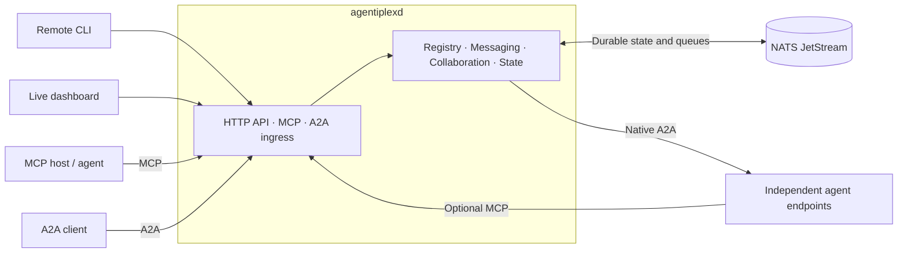

# Agentiplex

**Bring your own agents. Build your own organization.**

[](https://github.com/tbrandenburg/agentiplex/actions/workflows/ci.yaml)
[](https://github.com/tbrandenburg/agentiplex/actions/workflows/live-opencode.yaml)
[](https://github.com/tbrandenburg/agentiplex/releases)
[](https://go.dev/)
[](LICENSE)

Lightweight, open-source middleware for autonomous agent collaboration.
Discover agents, deliver tasks reliably, distribute work across teams and
share durable application state — independently of any model, IDE or agent framework.

[Quick start](#quick-start) · [Examples](#examples) · [Architecture](#architecture) · [Documentation](#documentation) · [Contributing](#contributing)

## Why Agentiplex?

Direct agent-to-agent communication is useful when every endpoint is known and
available. A team of independent agents also needs discovery, durable delivery,
shared context and visibility into what actually happened.

Agentiplex provides that infrastructure without deciding what agents should do,
how they should reason or where they should execute. Agents and their operators
own models, tools, workflows, workspaces and permissions.

| Capability | What it provides |
| --- | --- |
| **Discover** | Register existing A2A endpoints, publish an AI Catalog and find agents by skill, tag or group. |
| **Send** | Queue a task durably, track its downstream result and retry safe transient failures. |
| **Broadcast** | Deliver an update to every member of a configured group. |
| **Dispatch** | Assign work to one eligible member of a worker pool. |
| **Share state** | Store bounded, namespaced key/value context with revision checks. |
| **Observe** | Inspect agent health, delivery receipts and events through a remote CLI or live dashboard. |

## Quick start

Try the complete collaboration demo locally, without an LLM or API key.

**Prerequisites:** Git, Go 1.26+, GNU Make, Bash, curl, jq and Node/npm
(for packaging dashboard assets at build time).

```sh
git clone https://github.com/tbrandenburg/agentiplex.git
cd agentiplex
make demo-team
```

Open [the collaboration dashboard](http://127.0.0.1:18080/ui/).
Six independent simulated A2A agents demonstrate discovery, direct messages,
broadcast, pool dispatch, offline delivery and recovery across a daemon restart.
Press Ctrl+C to stop the demo, or use `make demo-check` for a noninteractive run.

The responses are deterministic fixtures, not model-generated engineering results.
See the [demo guide](docs/DEMO.md) for the scenario and how to attach a real agent.

### Connect your own agents

Run the daemon with its embedded broker and MCP endpoint:

```sh
make run
```

In a separate terminal, start a sample A2A endpoint:

```sh
make demo-agent
```

Register that endpoint and send a task from another terminal:

```sh
./bin/agentiplex register architect http://127.0.0.1:8001
./bin/agentiplex discover --skill architecture
./bin/agentiplex send architect "Review requirement 42" --idempotency-key demo-42
./bin/agentiplex messages status DELIVERY_ID
```

Replace `DELIVERY_ID` with the receipt ID returned by the send command.
The CLI talks to the daemon over HTTP; it never needs direct access to broker storage.

Existing A2A agents can be registered the same way. An MCP host can use
`http://127.0.0.1:8080/mcp` for discovery, messaging and shared state.
See the [A2A contract](docs/A2A.md) and [MCP tools](docs/MCP.md).

> [!IMPORTANT]
> Local examples are unauthenticated. Keep them on loopback in a trusted
> environment. For network deployment, configure authenticated TLS and
> approved outbound agent origins using the [deployment guide](docs/DEPLOYMENT.md).
>
> **Agent identity:** in secure mode every agent has its own bearer credential
> (`registry.agents.<id>.token_file` or `security.agent_token_files`); the server resolves it to the caller across A2A,
> MCP and REST. Agents see only their own deliveries and results, idempotency
> keys (required on every MCP/REST submission) are per agent, and note authors are set by the server. The former shared
> collaborator credential is removed (breaking change; see the principal model,
> access matrix, rotation and upgrade notes in [deployment](docs/DEPLOYMENT.md)).
> Shared team state is not tenant isolation.

## Static registry

Agents, groups and pools can be declared in the YAML `registry` block and are applied additively at startup before the daemon reports ready; see [deployment](docs/DEPLOYMENT.md#static-registry-declarative-provisioning) for schema, credentials and conflict/offline/omission semantics. Dynamic CLI/API registration remains available.

## Examples

Choose the level of collaboration you want to explore.

| Example | Command | What it demonstrates |
| --- | --- | --- |
| [Engineering team](docs/DEMO.md) | `make demo-team` | Six simulated agents; deterministic communication, persistence and recovery. |
| [Autonomous team](examples/autonomous-team/README.md) | [native commands](examples/autonomous-team/README.md) | Real model-driven delegation through A2A and MCP using synthetic fixtures. |
| [Repository team](examples/repository-team/README.md) | [native commands](examples/repository-team/README.md) | Five real agents working on the same Git worktree, with implementation and executable verification. |

The core is agent-runtime independent. The real-agent examples use an off-the-shelf
A2A agent driver; any A2A agent can be registered instead. Setup, prerequisites and
safety notes are in the [examples guide](examples/README.md). Real-agent runs
may transmit project content to the selected model provider and give agents
unrestricted shell access, so use a disposable environment.

## Architecture



- **`agentiplexd`** owns the registry, queues, shared state, delivery workers and optional dashboard.
- **`agentiplex`** administers the daemon remotely.
- **Agent runtimes** own task execution, sessions, tools and workspace access.
- **NATS JetStream** provides durable messaging and KV storage; use embedded or external NATS.

Implemented in Go with the official [A2A Go SDK](https://github.com/a2aproject/a2a-go),
[MCP Go SDK](https://github.com/modelcontextprotocol/go-sdk),
[AI Catalog SDK](https://github.com/Agent-Card/ai-catalog-go) and
[NATS JetStream](https://docs.nats.io/nats-concepts/jetstream).

Durable delivery is not exactly-once external execution. Ambiguous remote
outcomes remain visible instead of being silently replayed. Parallel outbound
operations are bounded by `agentiplexd --workers 4`; use one for serial execution.
See [architecture](docs/ARCH.md), [collaboration](docs/COLLABORATION.md) and
[lifecycle and state](docs/STATE.md) for the precise contracts.

## Installation and deployment

Download versioned native binaries and Helm packages from
[GitHub Releases](https://github.com/tbrandenburg/agentiplex/releases), or build
from source using `make build` (binaries in `bin/`).

| Deployment | Guide |
| --- | --- |
| Native daemon with embedded or external NATS | [Configuration and deployment](docs/DEPLOYMENT.md) |
| OCI image and secure Docker Compose | [Container deployment](docs/DEPLOYMENT.md), [Compose fixture](examples/engineering-team/) |
| Agents on other hosts (routed network/VPN, one daemon) | [Distributed deployment](docs/DEPLOYMENT.md#distributed-deployment-agents-on-other-hosts) |
| Single-replica Kubernetes / Helm | [Helm chart](deploy/helm/agentiplex/) and [deployment guide](docs/DEPLOYMENT.md) |

Agentiplex supports authenticated TLS deployments. Multiple replicas sharing
one namespace are not supported.

## Project status

**v0.1 — MVP stabilization.** A2A and MCP collaboration, durable state, the dashboard
and single-daemon deployment are implemented. AHP and ACP adapters are future
work, as are distributed ownership, production high availability and per-agent
or tenant isolation.

Agentiplex is a collaboration layer, not a model runtime, workflow engine,
filesystem sandbox or exactly-once execution system.

## Documentation

| Topic | Guide |
| --- | --- |
| Product direction and scope | [Requirements](docs/PRD.md) · [Architecture](docs/ARCH.md) |
| Protocols | [Native A2A](docs/A2A.md) · [MCP](docs/MCP.md) |
| Collaboration and operations | [Messaging, groups and pools](docs/COLLABORATION.md) · [Lifecycle and state](docs/STATE.md) |
| Dashboard and deployment | [Dashboard](docs/DASHBOARD.md) · [Secure deployment](docs/DEPLOYMENT.md) |
| Verification and history | [Foundation](docs/FOUNDATION.md) · [Engineering demo](docs/DEMO.md) |
| Maintainer tasks | [Release and packaging](docs/RELEASE.md) |

## Contributing

Bug reports and focused improvements are welcome. Open an
[issue](https://github.com/tbrandenburg/agentiplex/issues) or submit a
[pull request](https://github.com/tbrandenburg/agentiplex/pulls).
For larger changes, discuss the proposed scope and verification plan first.

```sh
make help       # All development and example targets
make fmt        # Format tracked Go source
make build      # Build daemon and CLI
make check      # Go tests, vet, Python and release-script tests
make demo-check # Deterministic end-to-end demo
```

For focused integration checks, use `make examples-check`,
`make repository-provision-check` or the explicitly opt-in `make live-check`.
The Go dependencies are pinned in `go.mod` and `go.sum`.
Make is the single development entry point.

See [release and packaging](docs/RELEASE.md) for publishing a version.
To stop monitoring an unresolved accepted task, follow the operator procedure
in the [deployment guide](docs/DEPLOYMENT.md); never assume an uncertain outcome
is safe to replay.

## License

[MIT](LICENSE). Third-party notices are retained with their respective components.
