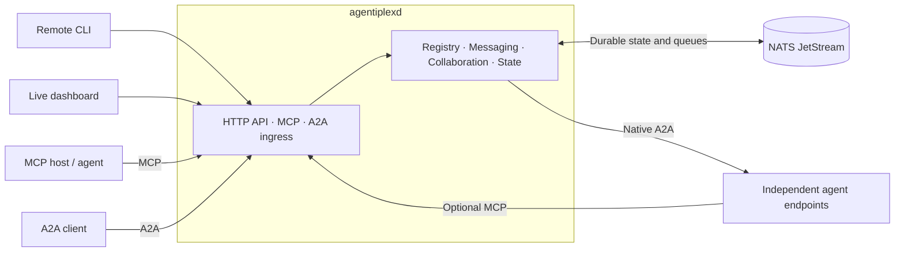

# Agentiplex

**Bring your own agents. Build your own organization.**

[](https://github.com/tbrandenburg/agentiplex/actions/workflows/ci.yaml)
[](https://github.com/tbrandenburg/agentiplex/actions/workflows/live-opencode.yaml)
[](https://github.com/tbrandenburg/agentiplex/releases)
[](https://go.dev/)
[](LICENSE)

**Discover, message and coordinate independent agents — with durable state and delivery.**
Agentiplex is lightweight, open-source collaboration middleware. Bring any A2A agent,
connect MCP tools, and let your agents own their work.

[Quick start](#quick-start) · [Contract collaboration](#contract-driven-collaboration) · [Examples](#examples) · [Architecture](#architecture) · [Deploy](#installation-and-deployment) · [Docs](#documentation)

## Why Agentiplex?

**One small CLI. No prescribed workflow, model or agent runtime.**

```sh
agentiplex discover --skill architecture
agentiplex send architect "Review requirement 42" --wait
agentiplex messages list
```

The CLI generates an idempotency key for each new submission. Reuse the key printed
on stderr with `--idempotency-key` to retry the same operation; use `messages wait ID`
to reconnect to admitted work. [Retry semantics](docs/COLLABORATION.md#cli).

With registered agents, configured groups and pools, you can also:

```sh
agentiplex broadcast engineering "Contract updated"
agentiplex dispatch testers "Verify requirement 42"
agentiplex state watch engineering
```

- **Connect:** agent discovery, AI Catalog, A2A and MCP.
- **Collaborate:** durable direct messages, broadcasts, worker pools and follow-through.
- **Share:** persistent notes and revision-checked shared state.
- **Observe:** delivery receipts, agent health and a live dashboard.

Agents own reasoning, models, tools and workspaces. Agentiplex owns the
communication and persistence. See [collaboration primitives](docs/COLLABORATION.md).

## Quick start

### Simulated team (no model or API key)

Start six deterministic A2A agents and the dashboard in three lines.

```sh
git clone https://github.com/tbrandenburg/agentiplex.git
cd agentiplex
make demo-team
```

Open [the dashboard](http://127.0.0.1:18080/ui/). Try direct messages, broadcast,
pool dispatch, offline delivery and restart recovery. Ctrl-C stops the demo;
`make demo-check` runs it noninteractively.
Requires Git, Go 1.26+, GNU Make, Bash, curl, jq and Node/npm.
[Demo guide](docs/DEMO.md).

> [!IMPORTANT]
> Run local examples only on loopback in a trusted, disposable environment.
> Use public or synthetic inputs with the free model. Read-only gateway policies
> are not OS sandboxes. For network deployment use [authenticated TLS and approved origins](docs/DEPLOYMENT.md).

### Three real agents

[](https://github.com/tbrandenburg/agentiplex/actions/workflows/discussion-quickstart.yaml)

A **lead, expert and critic** discuss a topic using native
[OpenCode A2A gateways](https://github.com/tbrandenburg/opencode-a2a-lite).
No launcher or orchestration code. The live CI test executes these exact commands.

<!-- discussion-quickstart:start -->
**Setup once.** On Linux with Git, Go 1.26+, Make, Bash, curl, Node 22+ and
Bun 1.4.4, clone this repository and run from its root. Install the two binaries
into `/usr/local/bin` (once; no PATH changes per terminal):

```sh
make build && sudo make install
npm install --global @opencode/cli@2.4.1 @tbrandenburg/opencode-a2a-lite@0.9.3
```

Use the prepared [example directory](examples/discussion-team/) directly. In each terminal, from the checkout root:

```sh
cd examples/discussion-team
```

**Start.** Run the daemon in one terminal and wait for its ready log.
State is stored in the user's standard state directory, outside the checkout:

```sh
agentiplexd --mcp
```

By default, storage is `$XDG_STATE_HOME/agentiplex` or `~/.local/state/agentiplex`.
Use `--storage` with a fresh path for a separate discussion; do not reuse unrelated work.
[Storage and upgrade notes](docs/DEPLOYMENT.md#daemon-storage).

Run one gateway command per other terminal, and wait for all three ready URLs:

```sh
opencode-a2a-lite --name lead --port 8001 --workspace workspace --system-prompt-file roles/lead.md --policy-file policies/coordinator.json --no-env
opencode-a2a-lite --name expert --port 8002 --workspace workspace --system-prompt-file roles/expert.md --policy-file policies/reader.json --no-env
opencode-a2a-lite --name critic --port 8003 --workspace workspace --system-prompt-file roles/critic.md --policy-file policies/reader.json --no-env
```

**Discuss.** From another terminal in the same example directory:

```sh
agentiplex register lead http://127.0.0.1:8001
agentiplex register expert http://127.0.0.1:8002
agentiplex register critic http://127.0.0.1:8003
agentiplex send lead "Should we use event sourcing?" --wait
agentiplex notes list discussion
```
<!-- discussion-quickstart:end -->

The lead returns a verdict, and notes show the shared findings.
Open [the dashboard](http://127.0.0.1:8080/ui/).
Ctrl-C detaches a waiting CLI or stops a foreground gateway/daemon;
`agentiplex messages wait DELIVERY_ID` reattaches to durable work.
Use free ports 8080 and 8001–8003 and a trusted, disposable checkout with
operator-owned, non-shared-writable policy paths outside the agent workspace. [Operating notes and verification](examples/discussion-team/README.md).

### Contract-driven collaboration

**Specify what must become true, not every step to get there.**
Use the same three running agents and example directory after outstanding deliveries settle.
Review the [decision contract](examples/discussion-team/contract.md) first.

<!-- discussion-contract:start -->
```sh
agentiplex send lead --file contract.md --until-done --max-turns 6 --timeout 12m --wait
```
<!-- discussion-contract:end -->

Agentiplex reactivates the lead across completed turns until it explicitly resolves
the objective and known work settles, or intervention is needed.
Progress survives CLI disconnect and daemon restart with the same storage.
No runner or inactivity nudge is needed.

Watch with `agentiplex state watch discussion-contract` or
`agentiplex messages list`. Use a dedicated, initially idle daemon with one
open until-done request. [Lifecycle and limits](docs/COLLABORATION.md#durable-follow-through-until-done).

### Actor-owned contract (direct handovers)

**A living Markdown checklist becomes the team's shared source of truth.**
The expert owns draft criteria, the critic owns review, the lead owns acceptance.
Actors work on unchecked boxes, record evidence, and pass responsibility directly
to the next actor. No permanent coordinator, workflow engine or new middleware mode.

With the same three running agents and no outstanding deliveries, review the
[approved objective](examples/discussion-team/objective-actors.md) and
[living Markdown template](examples/discussion-team/contract-actors.md).

<!-- discussion-actors:start -->
```sh
agentiplex state put discussion-actors objective --file objective-actors.md --revision 0
agentiplex state put discussion-actors contract --file contract-actors.md --revision 0
agentiplex send lead --file objective-actors.md --wait
```
<!-- discussion-actors:end -->

Watch the living document:

```sh
agentiplex state watch discussion-actors
```

The initial `--wait` observes only the first delivery. Overall completion means
all five boxes checked, `Status: done`, and all deliveries completed.
The local template stays unchanged; the living document is in shared state.

#### Actual observed contract progression

Three real agents completed this contract in about two minutes in the
[successful live CI run](https://github.com/tbrandenburg/agentiplex/actions/runs/46176104788).
These are actual observed revisions, not a scripted sequence.

| Revision | Responsibility | Observed outcome | Acceptance checklist | Progress |
| ---: | --- | --- | --- | ---: |
| 13 | Lead → Expert | Initial assignment | ⬜ ⬜ ⬜ ⬜ ⬜ | 0/5 |
| 14 | Expert → Critic | Initial draft | ✅ ✅ ⬜ ⬜ ⬜ | 2/5 |
| 16 | Critic → Expert | Rejected: missing recovery | ✅ ✅ ⬜ ⬜ ⬜ | 2/5 |
| 18 | Expert → Critic | Recovery evidence added | ✅ ✅ ✅ ⬜ ⬜ | 3/5 |
| 20 | Critic → Lead | Independent acceptance | ✅ ✅ ✅ ✅ ⬜ | 4/5 |
| 21 | Lead | Contract closed | ✅ ✅ ✅ ✅ ✅ | **5/5** |

Checkbox order: architecture comparison, consistency, failure recovery,
independent review, final acceptance.

The first draft deliberately omitted recovery. The critic rejected it, the
expert corrected it, and the critic accepted draft v2. The lead closed with
all five boxes checked. CI logs include the final Markdown and verify the
actual handovers and delivery receipts.

The contract determines whether work is done; the agents choose the next
action within its constraints. State updates and message admission are separate
operations, so a crash between them can stall a handover.
[Recovery limits and verification](examples/discussion-team/README.md#actor-owned-contract-direct-handovers).

Inspired by [Syspilot's Contract Driven Development](https://github.com/enthali/syspilot/blob/main/docs/methodology.md),
[Building with AI Agents](https://mikkosniemela.com/build-with-agents-2026-10-09)
and [Meta-Engineering Harnesses for AI-Native Software Production](https://arxiv.org/abs/2605.25665).
Conceptual references, not protocol-conformance claims.

### Connect your own agents

With Agentiplex installed as above, start a daemon with embedded NATS and MCP,
then a sample A2A agent in a separate terminal:

```sh
agentiplexd --mcp
```

```sh
make demo-agent
```

```sh
agentiplex register architect http://127.0.0.1:8001
agentiplex send architect "Review requirement 42" --wait
```

Use the same registration command with any existing A2A endpoint.
Connect MCP hosts to `http://127.0.0.1:8080/mcp`.
[A2A](docs/A2A.md) · [MCP tools](docs/MCP.md).

## Examples

| Example | What it demonstrates |
| --- | --- |
| [Simulated team](#simulated-team-no-model-or-api-key) | Deterministic communication, persistence and recovery (`make demo-team`). |
| [Three-agent discussion](#three-real-agents) | Real agents, shared notes and a verdict. |
| [Contract-driven collaboration](#contract-driven-collaboration) | Durable continuation until the lead resolves the objective. |
| [Actor-owned contract](#actor-owned-contract-direct-handovers) | Living Markdown, direct handovers and independently reviewed rework. |
| [Autonomous team](examples/autonomous-team/README.md) | Model-driven delegation through A2A and MCP. |
| [Repository team](examples/repository-team/README.md) | Five real agents, one Git worktree, executable verification. |
| [Contract-driven repository team](examples/repository-team/README.md#contract-driven-mode-opt-in) | Living checklist, bounded continuation and independent verification. |

[All examples and safety notes](examples/README.md). Real-agent runs may send
workspace content to model providers and grant shell access.

## Architecture



**`agentiplexd`** owns the broker-backed registry, queues, shared state and delivery
workers; **`agentiplex`** is a remote HTTP CLI. Independent runtimes execute tasks.
NATS JetStream provides durable messaging and KV storage, embedded or external.

Built in Go with the [A2A SDK](https://github.com/a2aproject/a2a-go),
[MCP SDK](https://github.com/modelcontextprotocol/go-sdk),
[AI Catalog SDK](https://github.com/Agent-Card/ai-catalog-go) and
[NATS JetStream](https://docs.nats.io/nats-concepts/jetstream).

Durable delivery is not exactly-once external execution: ambiguous outcomes are
visible rather than silently replayed. [Architecture](docs/ARCH.md) ·
[Delivery lifecycle](docs/COLLABORATION.md) · [State](docs/STATE.md).

## Installation and deployment

Download native binaries and Helm packages from [GitHub Releases](https://github.com/tbrandenburg/agentiplex/releases),
or install from source (Linux/macOS):

```sh
make build && sudo make install
```

The install target copies the built CLI and daemon to `/usr/local/bin`.
For a user-managed prefix already on PATH, use `make install PREFIX="$HOME/.local"`
after building. No sudo is needed for a writable prefix.

| Deploy | Guide |
| --- | --- |
| Native daemon, embedded or external NATS | [Deployment](docs/DEPLOYMENT.md) |
| OCI image / secure Docker Compose | [Deployment](docs/DEPLOYMENT.md#compose) · [Compose example](examples/engineering-team/) |
| Agents on other hosts / VPN | [Distributed deployment](docs/DEPLOYMENT.md#distributed-deployment-agents-on-other-hosts) |
| Single-replica Kubernetes | [Helm chart](deploy/helm/agentiplex/) |

Secure mode uses distinct per-agent credentials, caller-scoped delivery access and
idempotency keys, and server-attributed note authors. Shared state is not tenant
isolation. Multiple daemons sharing one namespace are not supported.
[Principal model, migration and security limits](docs/DEPLOYMENT.md).

### Static registry

Declare agents, groups and pools in YAML or register dynamically using the CLI/API.
[Declarative provisioning](docs/DEPLOYMENT.md#static-registry-declarative-provisioning).

## Project status

**v0.1 — MVP stabilization.** Native A2A and MCP, durable state, dashboard and
single-daemon deployment are implemented. AHP, ACP, distributed ownership, HA
and tenant isolation are future work. Agentiplex is not a model runtime,
workflow engine, filesystem sandbox or exactly-once execution system.

## Documentation

| Topic | Guide |
| --- | --- |
| Direction and design | [Requirements](docs/PRD.md) · [Architecture](docs/ARCH.md) |
| Protocols | [A2A](docs/A2A.md) · [MCP](docs/MCP.md) |
| Collaboration | [Messaging, groups and pools](docs/COLLABORATION.md) · [Lifecycle and state](docs/STATE.md) |
| Operations | [Dashboard](docs/DASHBOARD.md) · [Secure deployment](docs/DEPLOYMENT.md) |
| Verification | [Foundation](docs/FOUNDATION.md) · [Demo](docs/DEMO.md) · [CI](docs/CI.md) |
| Maintainers | [Release and packaging](docs/RELEASE.md) |

## Contributing

Open an [issue](https://github.com/tbrandenburg/agentiplex/issues) or
[pull request](https://github.com/tbrandenburg/agentiplex/pulls). For larger changes,
discuss scope and verification first.

```sh
make help
make build
make check
make demo-check
```

The public Go library is `github.com/tbrandenburg/agentiplex/core`.
See [repository layout](docs/ARCH.md#9-repository-layout) and
[CI workflows](docs/CI.md) for focused checks.

## License

[MIT](LICENSE). Third-party notices are retained with their respective components.
