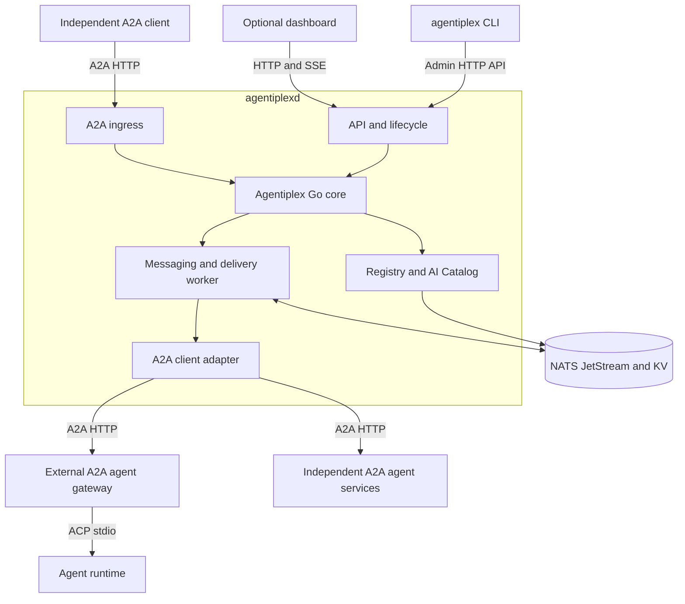
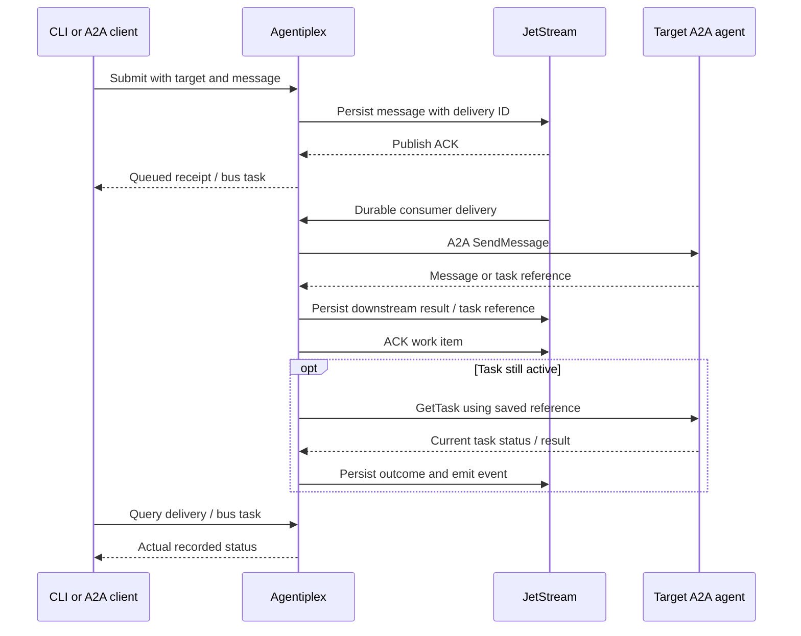

# Agentiplex — Architecture

**Status:** Initial design proposal / v0.1 demonstrator  
**Requirements:** [PRD](PRD.md)

## 1. Architecture decisions

| Decision | Rationale |
|---|---|
| One Go module; library-first modular monolith | Small public API, minimal glue, easy local build and future embedding. |
| Separate `agentiplexd` and `agentiplex` binaries | Headless daemon owns state and lifecycle; remote CLI uses the daemon API, never local database files. |
| NATS JetStream is an explicit infrastructure dependency | Reuse broker persistence, pull consumers, ACK/retry, KV, pub/sub and clustering; no generic broker abstraction or custom queue. |
| Native A2A 1.0 HTTP at the boundaries | Interoperate with existing agents and clients using official SDKs; NATS is internal, not a new claimed A2A binding. |
| AI Catalog as publication/discovery representation | Use existing catalog types and validation. JetStream KV implements the local mutable registry; no custom discovery standard. |
| No workflow orchestration | Supply communication primitives; applications own contracts, routing intent and reasoning. |
| Deployment via configuration | Same daemon for native, OCI and Kubernetes; platform packaging outside the Go core. Agents on other hosts need bidirectional HTTPS only: see [distributed deployment](DEPLOYMENT.md#distributed-deployment-agents-on-other-hosts). |

These are proposed initial decisions, not evidence of a working implementation.

## 2. System context



Agentiplex is both an A2A server (ingress) and client (egress). Each A2A interaction has client/server roles; a server-only agent does not automatically initiate outbound requests. Existing third-party A2A gateways remain unchanged. Mock agents or external A2A clients can initiate work with the daemon. A later MCP adapter can expose collaboration tools to agent runtimes.

## 3. Component boundaries

| Component | Owns | Reuses |
|---|---|---|
| Registry | Stable local IDs, endpoint/card metadata, membership, reachability observations, registration CRUD | A2A card resolver, JetStream KV |
| Catalog | Generate and validate current catalog; standard publication path | AI Catalog Go SDK |
| Messaging | Submission, subject conventions, direct/broadcast/pool intent, durable enqueue receipts | nats.go JetStream |
| Delivery | Durable consumption, A2A request/task correlation, retry classification, per-agent concurrency, recovery | JetStream consumers, A2A client |
| State | Namespaced application state, revisions, bounded values | JetStream KV |
| A2A ingress | Agent Card, structured operation requests, bus-task status, protocol errors | Official A2A server SDK |
| Daemon | Configuration, wiring, process lifecycle, health/readiness | Go standard library |
| Admin API / CLI | Explicit operator commands and queries | net/http, Cobra, Viper |
| Observability | Correlation, structured logs, event feed, optional dashboard | log/slog, SSE, embed; Prometheus/OTel as needed |

Keep domain types small. Use SDK types at protocol boundaries; preserve native A2A messages rather than lossy text-only conversion. Avoid duplicating SDK protocol models. Use narrow interfaces only for genuine boundaries/test seams. No speculative plugin system.

## 4. Registry and catalog

Registration input: stable local ID, base URL or card URL, optional group/pool membership and operator metadata. Resolve the card using the A2A SDK; verify protocol compatibility and supported interface; record the resolved endpoint, original card snapshot and fetch time. Validate subject-safe IDs or encode them without collisions. Agent names are display metadata, not authenticated identity.

Use KV revision checks for updates. Registration is not a heartbeat. Keep an unavailable agent registered and catalogued unless explicitly removed. Show reachability as observed reachable/unreachable/unknown with a timestamp. Removing a registration prevents new delivery; existing queued work must be explicitly handled, not silently discarded.

Publish the AI Catalog at `/.well-known/ai-catalog.json` with `application/ai-catalog+json`. Entries reference native A2A Agent Cards using the specification's artifact media type. Use SDK validation; do not invent catalog fields for local groups, health or queue status. For the local demo use URLs resolvable by the consumer; do not silently publish container-internal or unreachable addresses. Discovery filters are local application behavior, not a claim to implement an ARD registry API or federated discovery.

Optional static provisioning (`registry.agents/groups/pools` in the YAML) runs once at startup through the same `Register` and `SetCollection` paths, after storage/auth/transport init and before listening; it is additive, restart-idempotent and never edits queued or accepted delivery snapshots (see `docs/DEPLOYMENT.md`).

## 5. Messaging and storage

Use a configured namespace to isolate deployments on a shared NATS installation. The names below are illustrative logical resources; actual NATS stream/KV names are derived safely from the namespace.

| Resource | Subjects / keys | Policy |
|---|---|---|
| MAILBOXES stream | `<ns>.mailbox.<agent-id>` | File-backed work-queue retention; one non-overlapping durable pull consumer per agent; explicit ACK |
| POOLS stream (P1) | `<ns>.pool.<pool-id>` | File-backed work-queue retention; one shared durable pull consumer per pool |
| EVENTS stream | `<ns>.events.>` | Limits retention; replayable event history separate from work queues |
| REGISTRY KV | Agent IDs and group/pool definitions | Persisted cards/metadata, revision-based updates |
| DELIVERIES KV | Delivery ID | Request correlation, assigned recipient, attempts, outcome and task reference |
| INGRESS KV | Ingress A2A task ID | Durable inbound task correlation/state; use SDK store seam or implement only the small required persistent store |
| AGENT_STATE KV (P1) | Namespaced agent ID/key | Bounded application context, compare-and-set updates |

File storage and bounded retention/size/age are explicit configuration. Work streams use reject-new behavior when full where supported; never silently evict pending work as a success. Surface expiry or exhaustion. A single node is not HA. Use replication factor one locally and configure replicated external JetStream only when the cluster supports it.

Use JetStream Publish with server acknowledgment, not Core NATS publish, for durable operations. Broker delivery ACK and A2A task acceptance/completion are different events. Events are for visibility, not the authoritative work queue.

### 5.1 Internal envelope (versioned storage format, not a public wire protocol)

Fields: schema version, delivery ID, caller idempotency key (scoped to sender/operation), correlation ID, sender identity or declared local label, destination kind and ID, native A2A message payload, creation timestamp, optional parent broadcast ID, optional deadline. Do not expose broker subject syntax as the agent protocol.

### 5.2 Direct send



Record a stable ID before publish; acknowledge caller only after the broker confirms publication and the receipt is recoverable. Because KV, stream publish and HTTP are not one transaction, reconcile missing or incomplete records from durable messages on startup, and use the same ID for retries. JetStream deduplication is window-bounded; persistent idempotency records and revision checks are necessary beyond that window. Validate recovery under failure injection.

### 5.3 Delivery lifecycle and failure semantics

| State | Meaning |
|---|---|
| queued | Durable publish confirmed; not yet handed to target |
| attempting | Worker owns the current attempt |
| accepted | Downstream task reference durably recorded; execution may still be pending |
| input-required / auth-required | Downstream requires intervention; do not claim success |
| completed | Actual downstream result or completed task recorded |
| failed | Definitive rejection/failure, cancellation or exhausted safe retry policy (retain detail) |
| uncertain | Request may have executed but outcome is not known; requires reconciliation or operator decision |

Persist attempt intent before invoking external agents. On definitive transient pre-accept failures use bounded delayed redelivery; keep offline messages pending within configured limits. Extend ACK deadline while processing a long HTTP request. Persist downstream task ID/context ID or terminal message before acknowledging the work item. Recover accepted tasks by polling their existing ID, not by issuing a new prompt. Preserve downstream state separately from bus state. Persist terminal failure/uncertainty before settling the broker message; inspect or explicitly replay via operator action. Reconcile exhausted deliveries/advisories rather than assuming JetStream creates a dead-letter queue automatically.

An HTTP timeout or crash after transmission but before receipt may conceal a successful remote execution. A2A message IDs do not universally guarantee target-side idempotency. In the demo, mark such attempts uncertain unless the target demonstrably supports safe retries or correlation-based reconciliation. Do not automatically duplicate potentially side-effecting work. Broker at-least-once delivery is not end-to-end exactly-once execution. No claim of atomicity between application Git commits and message publication.

For agent runtimes that allow one active prompt (e.g. the example gateway), serialize prompts per endpoint/session (one active prompt); retain task/context identifiers where supported. Never interpret canceled, failed, input-required or unknown tasks as completed.

### 5.4 Broadcast and pooling (P1)

Broadcast snapshots group membership, creates deterministic child delivery IDs, and publishes one direct work item per recipient. Record a recoverable parent/child manifest and reconcile partial publication. Report aggregate and individual outcomes; not atomic all-or-nothing delivery.

Pool dispatch publishes one item to the pool subject. Worker loops associated with eligible agents share one durable pull consumer (not one independent consumer per member); only available members pull. Persist assignment before external invocation; honor capacity and keep the same target after acceptance or ambiguity. Only reassign definitively unaccepted work. For the single-daemon demo, local per-agent concurrency gates suffice; cross-replica ownership and leases are future work. Native queue groups alone are not durable pooling.

### 5.5 Day-long durability

Agent networks may run for days: work outlives connections, agent turns, daemon restarts and operator sessions. Design rules (each mechanism below already exists or is tracked as an issue):

| Rule | Mechanism |
|---|---|
| The durable record is the only source of truth | Delivery state lives in the DELIVERIES KV; nothing authoritative is held in memory, goroutines or a connection. |
| No wall-clock lifetime on accepted work | Only a single network operation is bounded (`delivery.timeout`). Accepted tasks are monitored until terminal (see "Accepted-task monitoring"); the runtime or operator owns execution deadlines. |
| Connections are disposable views | A blocking call (MCP `ask`, A2A `SendMessage`) only observes a durable record. A dropped connection, client timeout or daemon restart loses nothing; the caller re-attaches with the same required caller-created key (MCP/REST `idempotencyKey`, A2A `messageId`) and never causes a second downstream execution while the record is retained (`delivery.retention`, default 7 days; after that the same key is a new operation). |
| Unbounded waits are allowed | A wait ends on a terminal state, an explicit caller budget, or cancellation of the caller's own context. No server-side maximum, no extra configuration. |
| Waiting is event-driven with a safety net | Waiters use KV watch on the delivery key (current value first, then updates), not per-waiter polling. On watch error or reconnect they re-read the record, so a missed update cannot hang a wait. |
| Events record changes, not heartbeats | `delivery.state` is emitted only on a real state change so retention covers days of work. |
| Bounded retention never evicts pending work | Limits apply to events and terminal records; pending work is rejected at admission when full, never silently dropped. |
| Idempotent re-entry everywhere | Deterministic key-derived IDs and create-only writes make admission, reconciliation, recovery and re-attach safe to repeat. |
| Time-dependent behaviour is tested | Restart, reconnect and long-wait paths are tested with real JetStream and failure injection, using short intervals to stand in for days. |

**Crash and restart promise.** After any daemon exit, clean or not (SIGKILL, OOM, panic, host power loss), restarting `agentiplexd` resumes the team where it stopped: queued work is redelivered, `preparing` records are republished, accepted tasks keep their reservations and are monitored again, and waiters re-attach. The only state that does not resume automatically is a send that was in flight at the crash: it becomes `uncertain` and is never replayed (5.3). Agents see this as a failed tool call and continue by repeating the same call; the middleware does not resume an agent's own LLM turn.

| Failure | Guarantee |
|---|---|
| Daemon process exits or is killed | Nothing acknowledged is lost: the OS still flushes written data. Restart resumes as above. |
| Host crash or power loss (embedded broker) | Acknowledged writes must be on disk. The embedded broker therefore fsyncs every write (`SyncAlways`; setting `broker.sync`, default `always`; relax only by explicit configuration such as `2m`). The nats-server default is a 2 minute background fsync, which would lose acknowledged work and must not be relied on. |
| External or replicated NATS | Durability is the cluster's replication and storage configuration, documented in DEPLOYMENT.md. |

Verify with a kill test: SIGKILL the daemon during an active multi-agent run, restart it, and assert queued and accepted work completes with no duplicate downstream execution.

Consequence for features: a new wait, notification or collaboration primitive must work after a connection drop and a daemon restart, or it is not done.

### 6.1 A2A

Expose the daemon's own `/.well-known/agent-card.json` and official SDK HTTP handler. Advertise only implemented skills and capabilities. P0 supports a documented structured DataPart routing request with operation, target logical ID and payload; the rest is native A2A. This is an application-level skill contract, not a new A2A transport binding or standardized routing extension.

Return a bus-owned A2A task ID and persist its mapping to delivery ID. Support SendMessage and GetTask for implemented operations. The task tracks the requested operation through downstream completion/failure or intervention; a durable enqueue receipt is not completion. If the SDK needs a custom durable task store, implement that seam and test restart lookup; do not silently use a volatile task store while claiming recovery. Clearly document how downstream input-required/auth-required is surfaced; full permission relay, streaming, push notifications and cancellation propagation are deferred. Reject unsupported operations explicitly. Future skills may add discovery, broadcast and pool dispatch.

### 6.2 Admin HTTP API and CLI

Illustrative versioned API (not an implemented contract yet):

| Method/path | Purpose |
|---|---|
| POST /api/v1/agents | Register by URL and stable ID |
| GET /api/v1/agents | List/filter registrations |
| GET, DELETE /api/v1/agents/{id} | Inspect/remove |
| POST /api/v1/agents/{id}/refresh | Refresh card |
| POST /api/v1/messages | Submit direct delivery |
| POST /api/v1/broadcasts | Submit group broadcast (P1) |
| POST /api/v1/dispatches | Submit pool work (P1) |
| GET /api/v1/deliveries/{id} | Delivery status and task reference |
| GET /api/v1/events | SSE or replayable event feed |
| GET /healthz, /readyz | Liveness; readiness checks dependencies |
| GET /metrics | Optional metrics |
| GET /ui/ | Optional embedded dashboard |

The CLI uses the HTTP API (not direct NATS access):

```sh
agentiplexd --config config.yaml
agentiplex --server http://127.0.0.1:8080 register architect http://127.0.0.1:41241
agentiplex agents list
agentiplex discover --skill testing
agentiplex catalog get
agentiplex send architect "Review the requirements" --idempotency-key req-review-1
agentiplex messages status <delivery-id>
agentiplex events --follow
# P1:
agentiplex broadcast engineering "Contract updated" --idempotency-key release-1
agentiplex dispatch testers "Verify requirement 42" --idempotency-key verify-42
```

Commands and schemas are proposed; implement and document only the supported subset.

## 7. Configuration and deployment

Configuration precedence: CLI flags > environment variables > file > defaults. Use Cobra/Viper (or Go stdlib where simpler); validate at startup. Example:

```yaml
server:
  listen: "127.0.0.1:8080"
  public_url: "http://127.0.0.1:8080"
broker:
  mode: embedded
  listen: "127.0.0.1:4222"
  storage: "./data"
  replicas: 1
  # url: "nats://nats:4222"  # external mode
registry:
  namespace: engineering
catalog:
  enabled: true
protocols:
  a2a:
    enabled: true
delivery:
  max_attempts: 10
  retry_delay: 5s
  timeout: 120s
  max_pending_per_agent: 1
observability:
  log_level: info
  dashboard: false
```

Set explicit retention, payload limits and storage quotas before admitting work. Secrets belong in environment/secret files, not committed YAML. Embedded NATS listens locally; external NATS uses configured credentials and TLS where applicable. Readiness reflects connected broker, provisioned resources and ready handlers. Handle SIGTERM: stop admission/pulls, settle or safely release work, drain connections, stop embedded server.

| Mode | Topology |
|---|---|
| Native demo | One daemon with embedded NATS and persistent directory; CLI and agents are separate local processes |
| OCI container | Same daemon binary, mounted persistent storage (embedded) or external broker |
| Docker Compose | Daemon + official NATS container, persistent volume; other services on private network |
| Kubernetes | Single daemon replica initially; external NATS with official Helm chart and persistent volumes; service/port-forward or controlled ingress |
| Future HA | Multiple daemon replicas only after safe delivery ownership, reconciliation, auth and failover are demonstrated |

Use the same runtime code in all modes. No Docker/Kubernetes imports in the core. A container cannot reach a host's loopback address by using its own loopback; keep the first real-agent demo native or use an explicitly isolated shared network namespace. Do not expose its unauthenticated gateway via a public proxy.

## 8. Security and operational limits

The first demonstrator is trusted local infrastructure, not a production network service. Bind loopback by default; if using a private container network, restrict access and do not publish unauthenticated ports publicly. Allow only explicitly operator-approved outbound hosts/ports (including card-resolved interfaces); bound HTTP requests, redirects, response sizes and deadlines. Reject unapproved redirects, link-local/metadata services and endpoint changes; production SSRF/DNS-rebinding protections remain required. Treat cards/messages as untrusted data. Do not execute commands from cards.

Never treat declared sender names as principals: the server resolves the bearer credential to a principal (see below). Production deployment needs per-agent identity, authorization, TLS, broker ACLs and credential isolation. Do not store or log provider credentials; protect persistent state and avoid raw prompt/response bodies in default logs or metrics. Document that agent read-only policies (e.g. the example gateway's) are not an OS sandbox; use trusted disposable workspace, minimal credentials and no unrestricted shell for the demo.

## 9. Repository layout

Target layout (create directories only when implementing their functionality):

```text
agentiplex/
├── cmd/
│   ├── agentiplex/main.go
│   └── agentiplexd/main.go
├── core/                      # Public Go library; unit tests beside code
│   ├── bus.go
│   ├── agent.go
│   ├── registry.go
│   ├── messaging.go
│   ├── state.go
│   └── config.go
├── internal/
│   ├── daemon/                # Composition and lifecycle
│   ├── cli/                   # Remote CLI commands
│   ├── api/                   # Admin HTTP and SSE
│   ├── delivery/              # A2A delivery / recovery
│   ├── nats/                  # Embedded/external broker, streams, KV
│   ├── catalog/               # SDK integration
│   ├── adapters/
│   │   └── a2a/               # Ingress, egress, cards
│   ├── observability/         # Logging/events; metrics later
│   └── dashboard/             # Embedded static UI (P1)
├── deploy/
│   ├── config.example.yaml
│   ├── helm/
│   │   ├── agentiplex/
│   │   └── nats-values.yaml
│   └── systemd/agentiplexd.service
├── examples/
│   ├── simulated-agents/
│   └── engineering-team/
├── tests/
│   ├── integration/
│   ├── interoperability/
│   └── e2e/
├── docs/
│   ├── PRD.md
│   ├── ARCH.md
│   └── adr/                   # Add decisions as needed
├── .github/workflows/
├── Dockerfile
├── Makefile
├── go.mod
├── go.sum
├── README.md
└── LICENSE
```

The `core/` package exposes the small embeddable Go API and constructs built-in integrations. Its import path is `github.com/tbrandenburg/agentiplex/core` (previously `github.com/tbrandenburg/agentiplex`); existing Go consumers must update imports and package qualifiers. The module path and runtime protocols are unchanged. Keep shared implementation types in a leaf package if required to avoid import cycles; internal packages must not import `core` if `core` imports them. CLI calls the remote API, not embedded storage. Unit tests live beside code; integration/e2e tests use real broker/agents. No empty placeholders for future adapters. Add AHP (host control), ACP (runtime integration) and MCP (collaboration tools) under adapters only when needed.

## 10. Dependencies and implementation order

| Existing dependency | Use |
|---|---|
| [a2a-go/v2](https://github.com/a2aproject/a2a-go) | A2A 1.0 native server/client, cards, task APIs |
| [ai-catalog-go](https://github.com/Agent-Card/ai-catalog-go) | Catalog types, validation and discovery |
| [nats-server/v2](https://github.com/nats-io/nats-server) | Embedded broker |
| [nats.go](https://github.com/nats-io/nats.go) | JetStream, KV and consumer APIs |
| [Cobra](https://github.com/spf13/cobra) / [Viper](https://github.com/spf13/viper) | CLI/configuration |
| Go standard library | HTTP, logging, cancellation, testing, embedded web UI |
| [a2a-cli](https://github.com/a2aproject/a2a-cli) | Independent interoperability smoke test |
| [opencode-a2a-lite](https://github.com/tbrandenburg/opencode-a2a-lite) | Example real-agent driver via A2A/ACP |

Pin actual compatible versions in go.mod/go.sum and the demo setup after smoke tests. Verify SDK interfaces before writing adapters.

Implementation sequence:
1. Embedded/external JetStream lifecycle and deterministic SDK-based mock agent; persistent storage smoke test.
2. Registration, card resolution, validated AI Catalog publication and discovery.
3. Durable direct-send path, CLI, delivery status and failure classification; offline/restart tests.
4. Native A2A ingress with durable bus task status; independent client test.
5. P1 broadcast and pools, state, dashboard, real-agent smoke test, container packaging.
6. Future production security, multi-replica coordination and additional adapters after evidence.

## 11. Validation and reference material

Trace acceptance to [PRD](PRD.md). CI should run unit/integration tests and a provider-free end-to-end test with independent mock services, plus restart and ambiguous-failure injection. Add catalog validation and official A2A CLI interoperability tests; record tested protocol/SDK versions. Verify real agents separately on its documented supported runtime and report failures. The current design is not yet implemented or tested.

- [A2A protocol](https://a2a-protocol.org/) and [official Go SDK](https://github.com/a2aproject/a2a-go)
- [AI Catalog specification](https://github.com/Agent-Card/ai-catalog/blob/main/specification/ai-catalog.md) and [Go SDK](https://github.com/Agent-Card/ai-catalog-go)
- [JetStream](https://docs.nats.io/concepts/jetstream), [consumers](https://docs.nats.io/nats-concepts/jetstream/consumers), [streams](https://docs.nats.io/nats-concepts/jetstream/streams) and [KV](https://docs.nats.io/nats-concepts/jetstream/key-value-store)
- [NATS Kubernetes packaging](https://github.com/nats-io/k8s)
- [Go module layout](https://go.dev/doc/modules/layout)
- [Example gateway limitations](https://github.com/tbrandenburg/opencode-a2a-lite)

### PR #2 implementation refinement

For native A2A ingress, reuse the persisted delivery record as the bus task store rather than introducing a separate INGRESS KV bucket. The reserved `a2a-` task/delivery ID is derived from the incoming messageId; the original messageId is stored on the delivery record. GetTask projects the durable record into A2A status, correlation metadata and the original downstream response as a data artifact. This removes cross-store consistency problems. The SDK's transport-agnostic RequestHandler seam provides native JSON-RPC without a second executor. See [A2A.md](A2A.md) for the supported subset, retry rules and limitations.

### PR #3 implementation refinement

Group/pool definitions live in a separate COLLECTIONS JetStream KV bucket. Broadcast parents and deterministic child deliveries use the existing DELIVERIES KV bucket; the parent is an immutable recipient manifest, with aggregate status derived from child records. A periodic reconciliation worker completes interrupted fan-out. A POOLS stream holds one work item per dispatch; a durable pull consumer per pool feeds the same serial execution loop as direct delivery. The selector uses round-robin among reachable snapshot members and checks persisted active endpoints across queues. Assignment is recorded before external calls; accepted or ambiguous work is never reassigned. This is not yet parallel competing-worker execution or HA. Event subscriptions use JetStream replay with Core NATS wakeups and SSE. See [COLLABORATION.md](COLLABORATION.md).

The direct and pool consumers permit a bounded window of 64 outstanding broker messages rather than one. This lets delayed offline deliveries and active asynchronous tasks coexist with new work for other endpoints. The HTTP execution loop remains serial, with a persisted active-endpoint check; it does not claim parallel request workers.

### PR #4 implementation refinement

A read-only, embedded dashboard at /ui/ renders actual registry, collections, recent delivery summaries and retained/live SSE events. GET /api/v1/deliveries returns up to 100 top-level metadata-only summaries; detail lookup explicitly retrieves stored payloads. It uses a KV scan suitable for the small demonstrator, not a production index. The separate example driver starts six independent native A2A simulator processes and the daemon, executes a scripted requirement-review scenario, tests offline recovery across daemon restart and can substitute an operator-started real A2A Architect. The script is not a workflow engine. See [DEMO.md](DEMO.md).

### PR #4 dashboard refinement

Replace the handcrafted UI with the Apache-2.0 AMIS 6.13.0 browser SDK. The entire default visual layout is declarative JSON; only a bootstrap and read-only presentation data adapter are maintained. Pin and package unmodified assets at build time, embed into the daemon, and support operator-provided trusted schema files and upstream themes. AMIS automatic polling replaces handwritten DOM/SSE updates; the existing API and SSE event contract are unchanged. See [DASHBOARD.md](DASHBOARD.md).

### PR #5 implementation refinement

Registration card snapshots are refreshed only for the same endpoint, using native KV revision checks; observations have their own timestamp and do not overwrite card metadata on failure. Removal rejects agents referenced by current collections or nonterminal delivery snapshots. Health means a compatible card was observed, not a guaranteed executable endpoint. Busy is derived separately from persisted active endpoints. Application state uses one dedicated bounded AGENT_STATE KV bucket per deployment namespace, keys encoded as namespace.key, native CAS and KV Watch; namespaces are labels rather than security boundaries. See [STATE.md](STATE.md).

### PR #6 implementation refinement

The official MCP Go SDK supplies an optional stateless Streamable HTTP adapter at /mcp. Typed tools reuse Bus methods directly, including durable admission, delivery lookup and native KV CAS; no agent runtime, protocol translation service, second broker or task store. Tool metadata is distinct from A2A Agent Cards; no unsupported MCP resources/subscriptions or sampling advertised. MCP is disabled by default, loopback-only with browser Origin rejection and SDK DNS rebinding protection, not an authenticated boundary. See [MCP.md](MCP.md).

### PR #7 implementation refinement

An optional static credential boundary (operator, dashboard viewer and one credential per named agent) requires native TLS, explicit HTTPS advertised origin and mounted credentials. The public probes and bus Agent Card contain no credentials; all other routes are authenticated in secure mode. Outbound A2A uses approved HTTPS origin-scoped bearer credentials and verified CA roots; external NATS uses native token/credentials and TLS options. Each named agent has its own credential; Auth resolves a bearer token once to a `security.Principal{Role,AgentID}` stored in the request context for A2A, MCP and REST, and the core reads only that principal (never request-supplied sender/author/client name). Deliveries, broadcast children, events and notes persist the immutable caller ID; idempotency keys and A2A messageIds are hashed together with the caller; named agents read only their own deliveries and results; the global delivery list and event feed are operator-only. State is shared team context, not tenant isolation; there is no distributed ownership. Provisioning, rotation, the access matrix and the upgrade boundary are in [DEPLOYMENT.md](DEPLOYMENT.md). Compose uses official NATS and isolated simulator endpoints; Helm deploys one daemon with Recreate strategy and external official NATS. See [DEPLOYMENT.md](DEPLOYMENT.md).

### PR #8 autonomous example

The disposable team example is deliberately outside the core. OpenCode 2.3.2 and opencode-a2a-lite 0.9.0 provide independent agent execution. Static native OpenCode profiles and exact read-only gateway policy files permit the PM to delegate via existing MCP tools; workers can inspect and exchange KV context but cannot delegate through MCP in this profile. The operator starts the agents with native commands and `agentiplexd --config team.yaml`, then submits one initial objective; the agents collaborate on their own. No planner or workflow engine was introduced. Provider-free tests verify active A2A task -> MCP delegation -> A2A recipient completion; real model decisions require separately observed live acceptance.

### Accepted-task monitoring refinement (PR #8)

A2A asynchronous admission and execution lifetime are separate. The delivery timeout bounds individual HTTP operations; MaxAttempts bounds pre-submission reachability only. An accepted task retains its downstream task ID, assigned endpoint, last valid snapshot and busy reservation across successful polls, transient errors and restart. Read-only GetTask monitoring has no absolute lifetime or total-poll cap; consecutive failures use exponential backoff capped at one minute and reset on valid observation. The existing delivery record stores cumulative polls, consecutive poll failures and lastObservedAt. No automatic resubmission, reassignment or cancellation. An indefinitely unavailable recipient can hold the reservation and durable queue capacity until a terminal status is observed; explicit operator reconciliation is a future feature. The runtime/operator owns execution deadlines. The gateway implements configurable prompt deadlines via `--prompt-timeout`. Existing already-terminal uncertain records are not automatically reopened.

### MVP stabilization (PR #9)

One daemon per namespace remains a deployment contract. A bounded local worker pool (default four, maximum sixteen) shares the existing durable direct and pool consumers. Fetch only when a slot is available; renew ACK leases in flight. Local delivery ownership prevents duplicate concurrent redelivery; endpoint capacity is checked and attempting intent persisted atomically under the existing mutex after an out-of-lock card probe. Accepted records retain reservations across restart. Network operations run outside the admission mutex. Per-endpoint ordering is not guaranteed. No new broker resources or distributed leases. Operator-only abandonment requires the exact downstream task ID and explicit confirmation that remote execution has stopped; it marks accepted work uncertain, preserves evidence, and releases local reservation without cancellation or replay. Reject abandonment while a local operation owns the delivery. HA, indexing, performance targets, AHP/ACP and federation remain backlog until actual usage justifies them.
